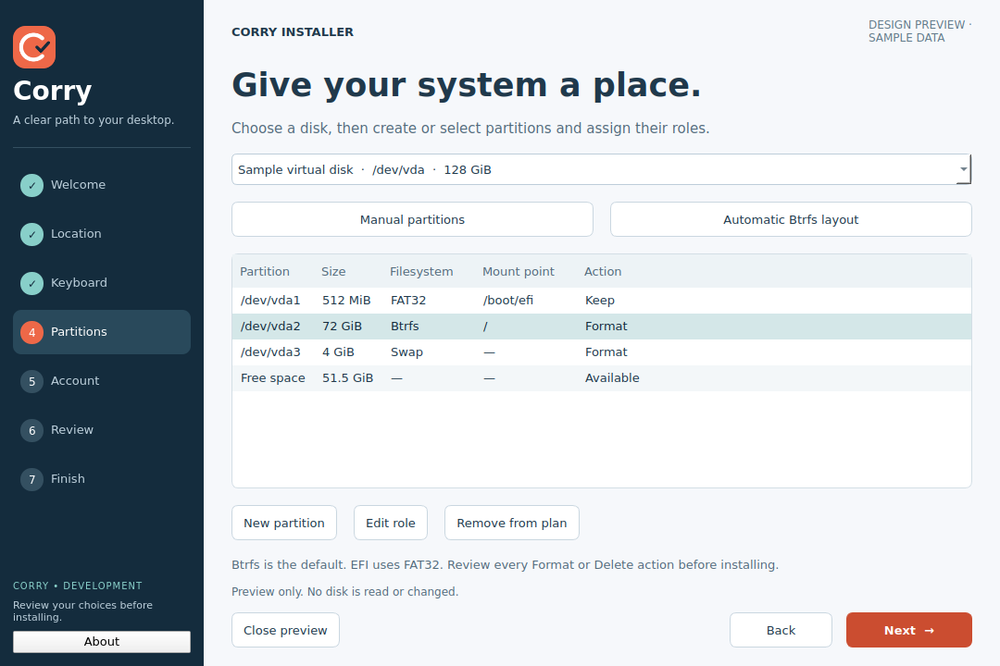

<!-- SPDX-License-Identifier: CC0-1.0 -->
# Corry Installer

Corry is an early development fork of **Calamares 3.3.15** for Debian-based live images.
It keeps Calamares' installation engine and adds original Corry branding, a guided
step list, partition-role shortcuts, and an explicit Debian configuration.



**The screenshots are from a safe Qt design preview with sample data.** The preview
shares production artwork, QSS and sidebar QML. Its page bodies are a storyboard,
not evidence of a completed ISO installation or an exact rendering of every native page.

## Included in this development iteration

- Original Corry C/check mark, navy/coral/teal palette and numbered, scrollable sidebar.
- Language → location → keyboard → partitions → account → review → installation → finish.
- Btrfs by default; automatic layouts also offer ext4 and XFS.
- Manual Root, Home, EFI, Boot, Swap, Var and Tmp shortcuts, with editable mount points.
- Available manual filesystems depend on KPMcore tools and live-kernel support.
- User passwords accept **one character or more**, require matching confirmation, and
  reject empty passwords. Corry does not alter the installed system's PAM policy.
- Debian dependency/build/profile scripts and read-only launcher preflight checks.
- Explicit final installation confirmation; no destructive partitioning mode is preselected.

Read [the development and integration guide](docs/CORRY-DEVELOPMENT.md) before ISO integration.
The native partition shortcuts require building this fork; installing just the profile
on Debian's packaged Calamares changes branding and configuration only.

## Build in a Debian development machine or ISO build chroot

```bash
sudo bash tools/install-dependencies.sh build
bash tools/build-corry.sh
QT_QPA_PLATFORM=offscreen ctest --test-dir build-corry \
  -R '^(userstest|partitionconfigtest|corrypartitiontest)$' --output-on-failure
sudo cmake --install build-corry
sudo bash tools/install-profile.sh
```

The source build uses the existing `calamares` executable/API paths. Installing to
`/usr` replaces files from the Debian backend package. Use an isolated development
machine/ISO chroot for this early integration; dedicated Debian packaging is future work.
Set `CORRY_BUILD_JOBS` to tune compilation parallelism. Debian 12 uses Qt5; Debian 13 uses Qt6.

The default live image path is `/run/live/medium/live/filesystem.squashfs`. To change it:

```bash
sudo bash tools/install-profile.sh --image /run/live/medium/live/custom.squashfs
```

Include runtime dependencies **before** packing the live root filesystem. Ensure the
squashfs contains the target kernel, firmware, desktop, login manager and bootloader
utilities. The scripts do not build or validate those distribution-specific payloads.

## Safe design preview

```bash
python3 -m venv .venv
. .venv/bin/activate
pip install PySide6
python tools/preview.py
# Regenerate screenshots without accessing any disk:
QT_QPA_PLATFORM=offscreen python tools/preview.py --screenshots docs/screenshots
```

The preview cannot run an installation. Native backend checks are separate from preview checks.

## Upstream and licensing

Calamares is free software. All upstream copyright notices and per-file licenses are
retained in this fork; see `LICENSES/` and each file's SPDX identifier. New Corry code
uses GPL-3.0-or-later unless marked otherwise; new Corry artwork/configuration is CC0-1.0.
No Microsoft logos, screenshots, artwork, or proprietary installer assets are shipped.
Upstream development: https://codeberg.org/Calamares/calamares
