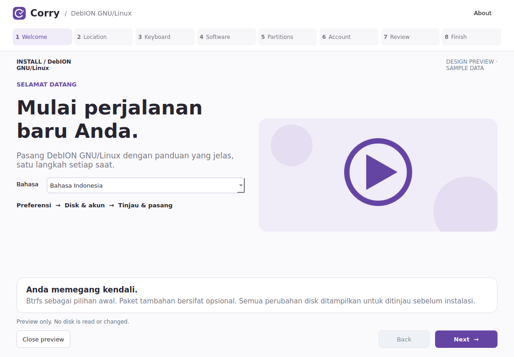

<!-- SPDX-License-Identifier: CC0-1.0 -->
# Corry Installer

Corry is an early development fork of **Calamares 3.3.15** for **Edukasaun OS** and
**DebION GNU/Linux**, with a shared installation engine and separate product assets.



The screenshots are **Qt design previews with sample data**. They share production
QML, styles and artwork. Page bodies are a storyboard, not exact captures of every
native page or evidence of a successful ISO installation.

## This revision

- Horizontal step menu, wider workspace and a two-column native welcome page.
- Language → location → keyboard → software → partitions → account → review → install.
- Separate names, palettes, artwork, slideshow manifests and software catalogs for both OSes.
- Local image slideshow with automatic advance, pause, previous and next controls.
- Signed repository check, retry button and optional software selected with ordinary clicks.
- Dependencies resolved against the **installation image's** package status. All required
  downloads complete **before partitioning**; target package installation uses `--no-download`.
- Offline base installation when the image already contains required packages and its kernel.
- Btrfs default; ext4/XFS alternatives; manual Root/Home/EFI/Boot/Swap/Var/Tmp shortcuts.
- Passwords accept one character or more; empty or mismatched passwords are rejected.
- Explicit disk-operation confirmation and Debian 12/Qt5 + Debian 13/Qt6 CI builds.

The configuration is a maintained in-repository fork of
[CatalystDevOrg/calamares-settings-debian](https://github.com/CatalystDevOrg/calamares-settings-debian).
The imported source, ISC license and pinned revision are in `config/upstream/catalyst`.
Linux Mint Live Installer informs the guided workflow and slideshow behavior; its
Python engine and artwork are not copied. See [source provenance](config/upstream/catalyst/UPSTREAM.md).

## Build and integrate

Run inside a disposable Debian development machine or ISO-build chroot:

```bash
sudo bash tools/install-dependencies.sh build
bash tools/build-corry.sh
python3 tools/test-profile.py
python3 tools/test-software.py
QT_QPA_PLATFORM=offscreen ctest --test-dir build-corry \
  -R '^(userstest|partitionconfigtest|corrypartitiontest|packagechoosertest)$' --output-on-failure
sudo cmake --install build-corry
sudo bash tools/install-profile.sh --distro edukasaun
# Or, for a different ISO build root:
# sudo bash tools/install-profile.sh --distro debion
```

The existing `calamares` executable/API paths are retained. Installing under `/usr`
replaces files supplied by Debian's backend package; dedicated Debian packaging is
future work. Include the built Corry backend and selected profile in the live ISO,
and use `corry-installer.desktop` as its installer launcher.

For derivatives, set `CORRY_DEBIAN_VERSION=12` or `13` to their actual Debian base
when running the dependency and build scripts. Set `CORRY_BUILD_JOBS` to tune parallelism.
The default image is `/run/live/medium/live/filesystem.squashfs`; override it with
`--image /absolute/path.squashfs`. `DESTDIR` supports staging both profiles independently.

Include runtime dependencies **before packing** the squashfs. The payload must
contain a Debian kernel, firmware, desktop, login manager and correct signed APT
sources/keyrings. Corry does not manufacture or validate a complete distro ISO.
Read the [integration and testing guide](docs/CORRY-DEVELOPMENT.md).

## Edit a distro without changing the engine

Edit only `config/distros/edukasaun/` or `config/distros/debion/`:

- `branding.desc`: displayed product names and links.
- `profile.yaml`: accent colors.
- `slides/slides.json`: image order, titles and descriptions. Images can be SVG, PNG or JPEG.
- `slides/`: original local artwork or your own distro images.
- `software.yaml`: mandatory packages and optional package groups.

Re-run `install-profile.sh --distro …` after editing. It generates the package chooser
and slideshow JavaScript from these manifests, keeping frontend/backend choices aligned.

## Safe preview

```bash
pip install PySide6 PyYAML
python3 tools/preview.py --distro edukasaun
QT_QPA_PLATFORM=offscreen python3 tools/preview.py --distro debion --screenshots docs/screenshots
```

The preview cannot install or access disks. Its repository status is explicitly simulated.
The signed APT integration test uses temporary package roots in CI, not physical disks.
A full ISO install and reboot in BIOS/UEFI VMs is still required before release.

## Licensing

Upstream per-file licenses and notices are retained; see `LICENSES/`. New Corry code
uses GPL-3.0-or-later unless marked otherwise; original artwork is CC0-1.0. The imported
Catalyst configuration retains its ISC notice. No Microsoft, Mint or Catalyst artwork
is shipped. Calamares upstream: https://codeberg.org/Calamares/calamares
