<!-- SPDX-License-Identifier: CC0-1.0 -->
# Corry Installer 0.1

> **Status: in development (0.1).** Corry has not yet been validated by full ISO
> installations on real hardware. Do not use it on a computer with data you
> cannot afford to lose.

Corry is the default system installer for **Edukasaun OS** and
**DebION GNU/Linux**. It is a fork of **Calamares 3.3.15** with one shared
installation engine and an easily edited profile per distribution. Both
distributions are built on **Debian stable (13 "trixie")** and **Debian testing**;
Corry supports exactly those two bases.

## Screenshots, start to finish

Captured from the **real Corry 0.1 build** running on a virtual display
(`tools/screenshots/capture.sh`), except the two partition pages marked
*preview*: a container has no disks to list, so those come from the design
preview (`tools/preview.py`). The real capture run skips the partition step, so
the header counts 8 steps there instead of 9.

| | |
| --- | --- |
| 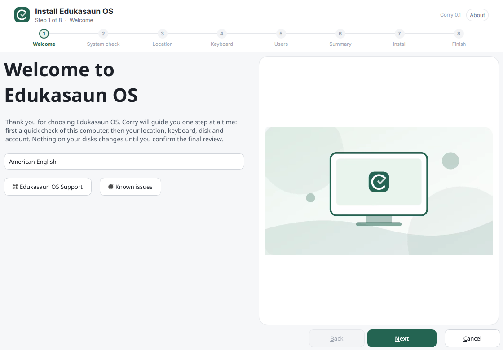 **1 · Welcome** with the product video | 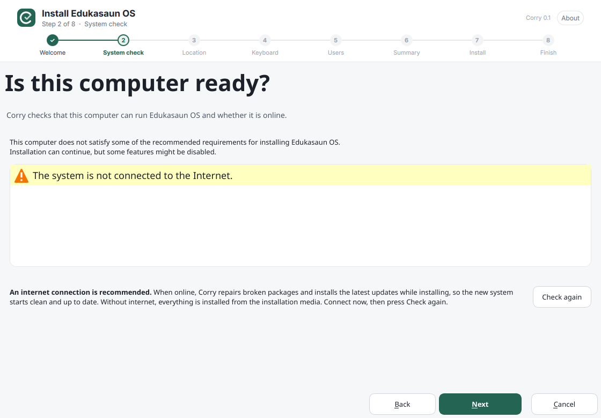 **2 · System check** and internet recommendation |
| 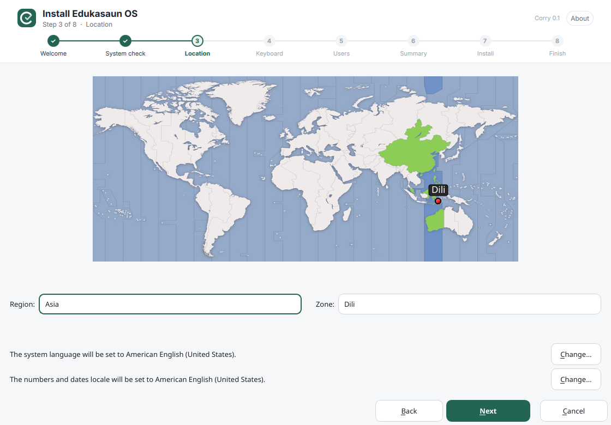 **3 · Location** | 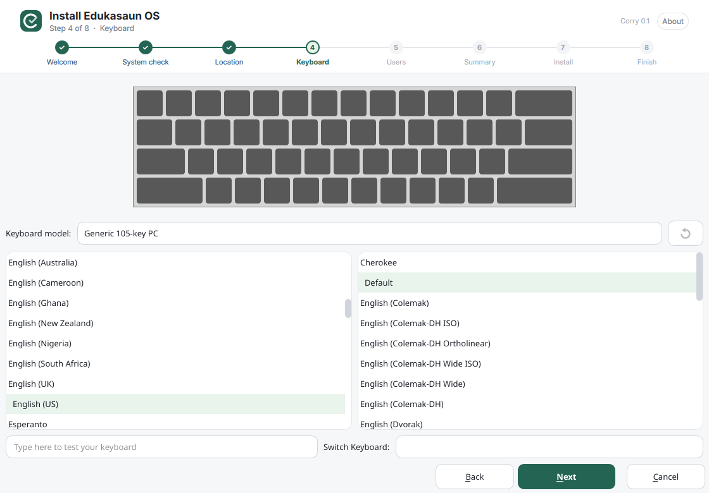 **4 · Keyboard** |
| 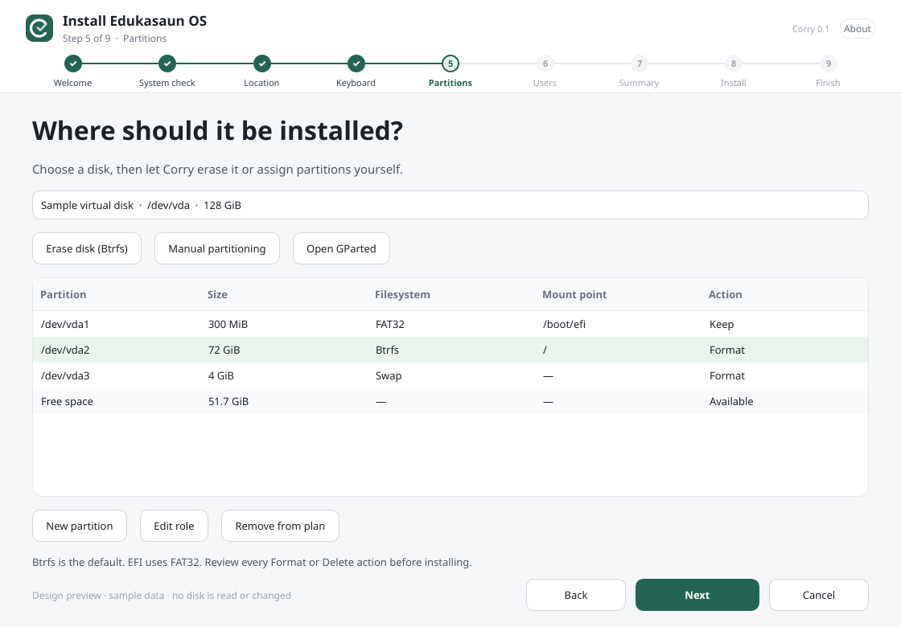 **5 · Partitions** with *Open GParted* (preview) | 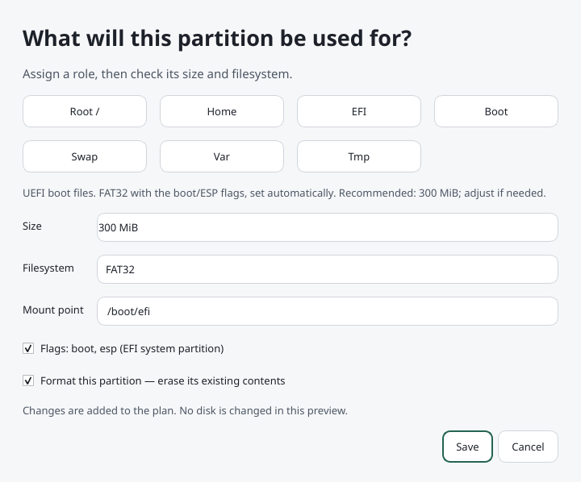 **EFI role: 300 MiB, boot/ESP flags set automatically** (preview) |
| 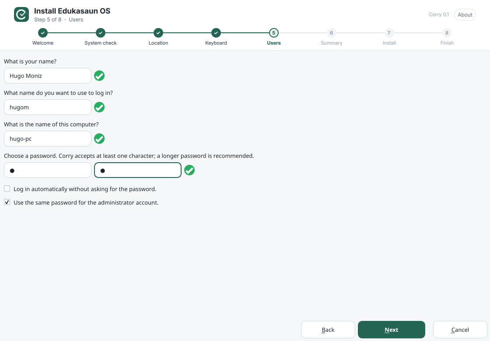 **5 · Users**: same password for the administrator | 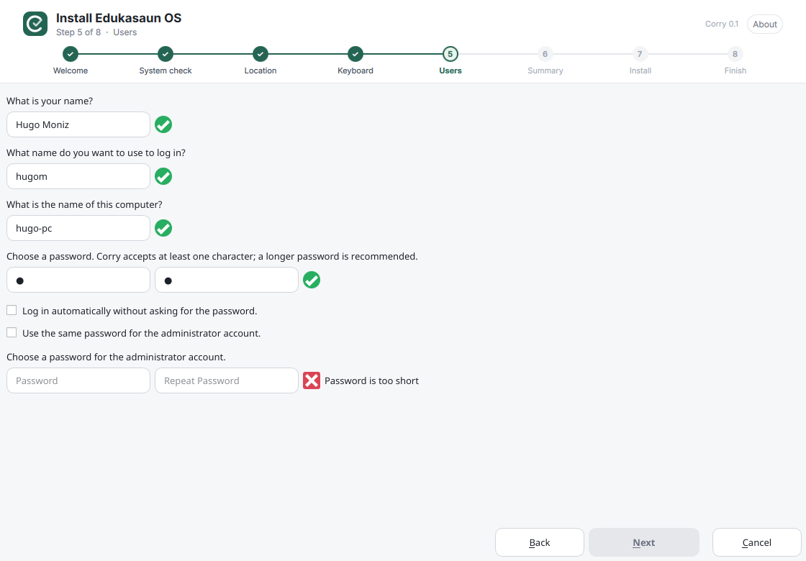 **…or a different administrator password** |
| 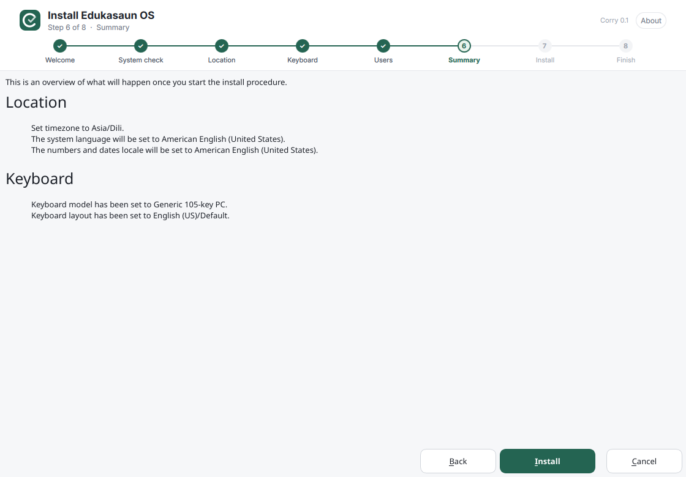 **6 · Summary** | 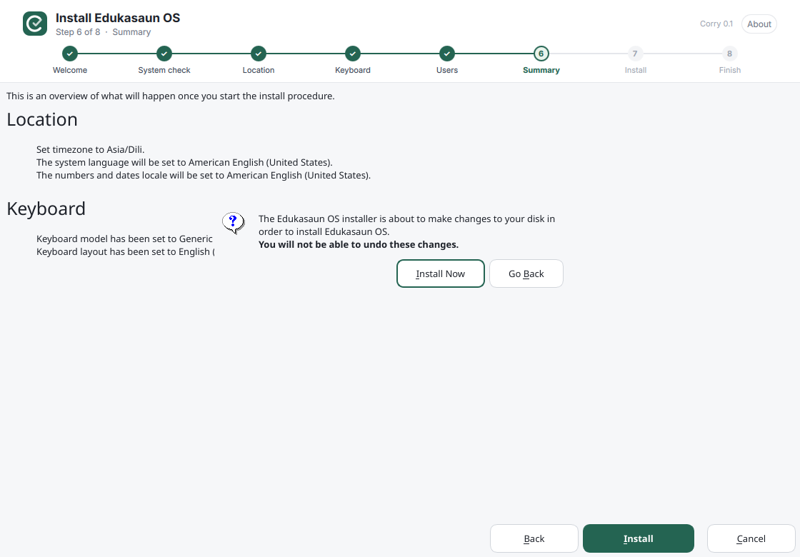 **Final confirmation** |
| 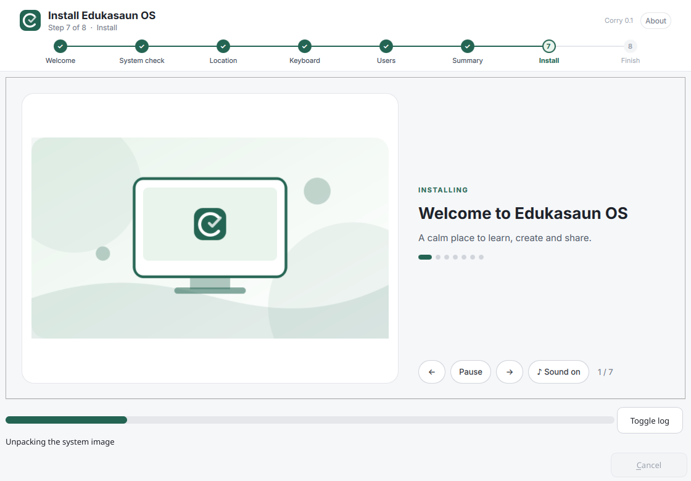 **7 · Install**: slideshow with music | 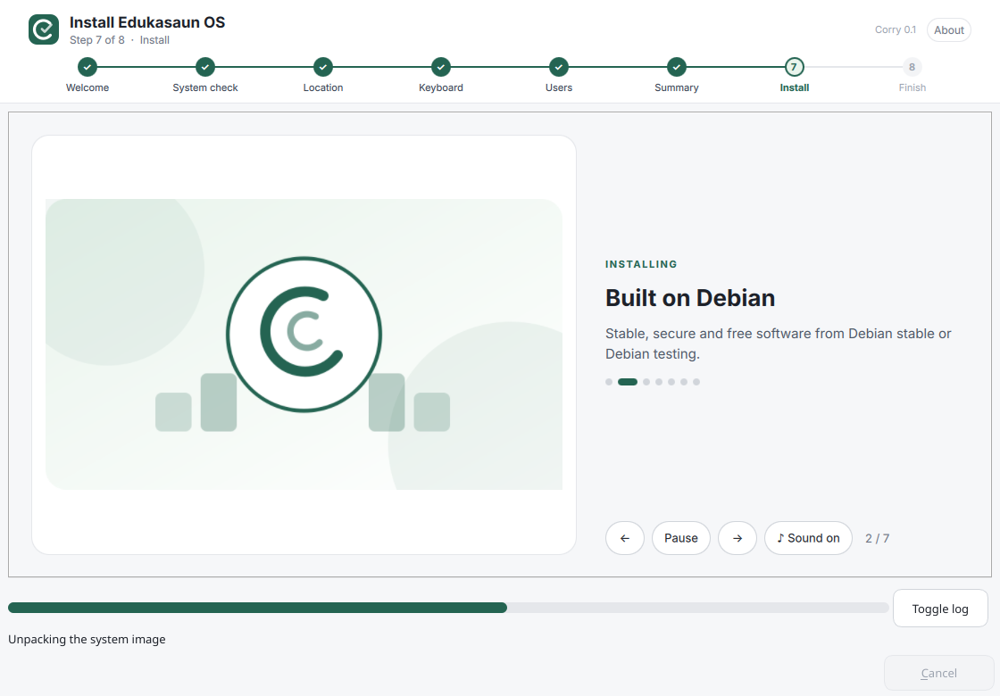 **7 slides with recommendations** |
| 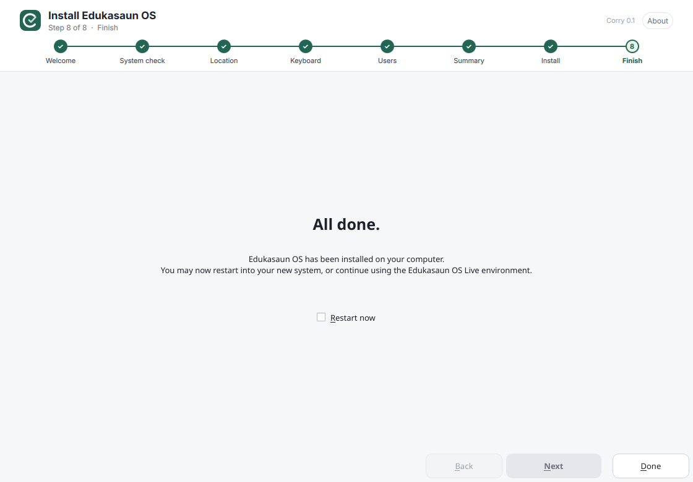 **8 · Finish** | 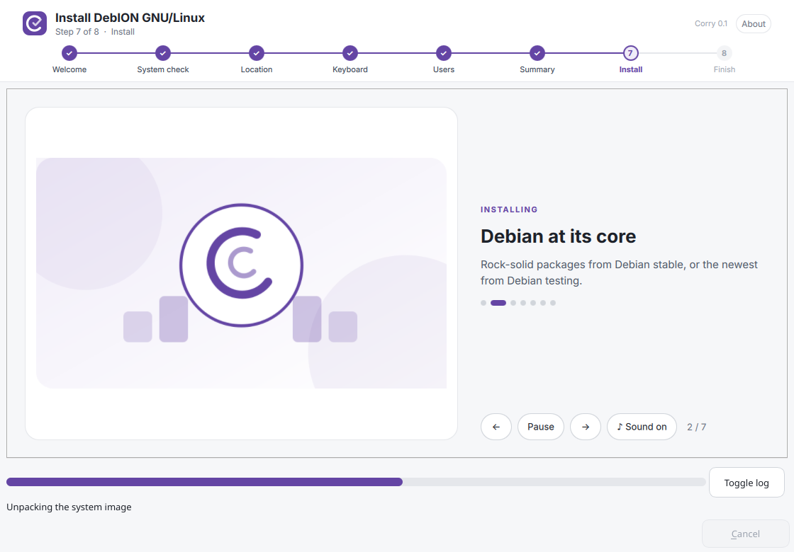 **DebION GNU/Linux** (same engine, own profile) |

All DebION GNU/Linux screenshots are in [`docs/screenshots`](docs/screenshots).

## What Corry does

- **Welcome** greets the user with a short, muted, looping product video (or an image)
  and offers the language. **System check** follows on its own page: disk space,
  memory, power, administrator rights, screen and **internet**, with a *Check again* button.
- **Works with and without internet.** Without it, everything comes from the
  installation media. With it — which Corry recommends — Corry also repairs broken
  packages and installs updates during installation, and can download the GRUB
  package if the media lacks it. Network problems never fail the installation.
- **Partitions:** erase disk (Btrfs by default, ext4 and XFS available), manual
  partitioning with Root/Home/EFI/Boot/Swap/Var/Tmp role buttons, or **Open GParted**;
  disks are re-read when GParted closes. Choosing **EFI** proposes **300 MiB** FAT32
  and sets the **boot/ESP flags automatically**; the size stays adjustable.
- **Users:** one checkbox decides whether the administrator (root) account uses
  **the same password** as the user or **a different one**.
- **Legacy BIOS and UEFI:** BIOS installs use an MBR disk and `grub-pc`; UEFI installs
  use GPT, a 300 MiB EFI partition and `grub-efi-amd64`. os-prober is enabled for dual boot.
- **Installation:** a slideshow of at least five images (seven by default) with tips,
  and calm background music that can be muted.
- **Leaves no trace.** After installation the new system contains no Corry or
  Calamares files, packages, launchers, menu entries or configuration.
- **Easy branding:** one `distro.yaml` per distribution holds names, colors, links,
  video, music and slides. `tools/new-distro.py` creates a new profile in one command.
- US English (`en_US.UTF-8`) by default; other languages can be chosen on the welcome page.

## Build and integrate

Run inside a disposable Debian stable or testing machine, or in the ISO build chroot:

```bash
sudo bash tools/install-dependencies.sh build
bash tools/build-corry.sh
python3 tools/test-profile.py
QT_QPA_PLATFORM=offscreen ctest --test-dir build-corry \
  -R '^(userstest|partitionconfigtest|corrypartitiontest|welcometest)$' --output-on-failure
sudo bash tools/install-corry.sh build-corry          # records every file for self-removal
sudo bash tools/install-profile.sh --distro edukasaun # or: --distro debion
```

The scripts detect the Debian base from `/etc/debian_version` (`13.x` is stable,
`forky/sid` or `14.x` is testing). If a derivative changes that file, set
`CORRY_DEBIAN_BASE=stable` or `CORRY_DEBIAN_BASE=testing`. Both bases use Qt 6.

Always install with `tools/install-corry.sh`, not plain `cmake --install`: it
writes `/usr/lib/corry/manifest`, which the installed system uses to remove Corry
completely.

`install-profile.sh` makes Corry the live session's default installer: an
"Install Edukasaun OS" / "Install DebION GNU/Linux" menu entry, a desktop icon for
the live user, Debian's generic `calamares`/`install-debian` entries hidden, and
the `install-debian` command redirected to Corry (`--autostart` also opens Corry
when the live session starts). Do not add `calamares-settings-debian` to the image.

The live image must contain everything the installed system needs: a Debian
kernel, firmware, desktop, login manager, initramfs-tools, `grub2-common`,
`grub-pc-bin` and `grub-efi-amd64-bin` (ideally also `grub-pc`/`grub-efi-amd64` in the
ISO's package pool), plus Corry's runtime dependencies
(`tools/install-dependencies.sh runtime`, which includes GParted and QtMultimedia).

- [Integration and testing guide](docs/CORRY-DEVELOPMENT.md)
- [Branding guide: edit or add a distribution](docs/BRANDING.md)
- [Calamares review and recommendations](docs/RECOMMENDATIONS.md)
- [Changelog](CHANGELOG-CORRY.md)

CI builds Corry on `debian:stable` and `debian:testing` and uploads development
archives for both distributions with SHA256 checksums. They are staged file trees
for ISO-build testing, not signed Debian packages or tested release ISOs.

## Licensing

Upstream per-file licenses and notices are retained; see `LICENSES/`. New Corry code
uses GPL-3.0-or-later unless marked otherwise. The slide artwork, welcome video and
background music are original, generated by `tools/generate-default-media.py`, and
CC0-1.0. The configuration is derived from
[CatalystDevOrg/calamares-settings-debian](https://github.com/CatalystDevOrg/calamares-settings-debian),
kept in `config/upstream/catalyst` with its ISC notice
([source provenance](config/upstream/catalyst/UPSTREAM.md)). Calamares upstream:
https://codeberg.org/Calamares/calamares
