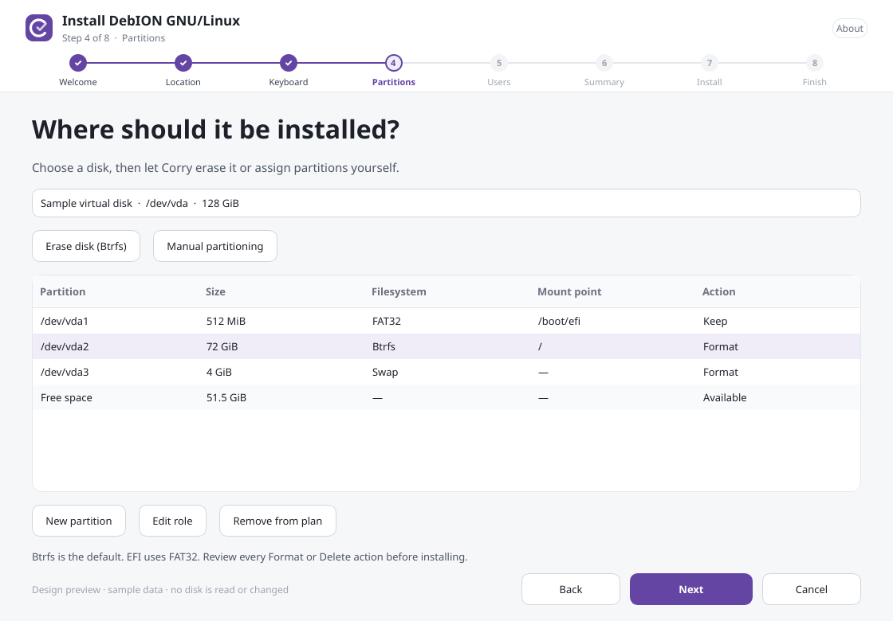
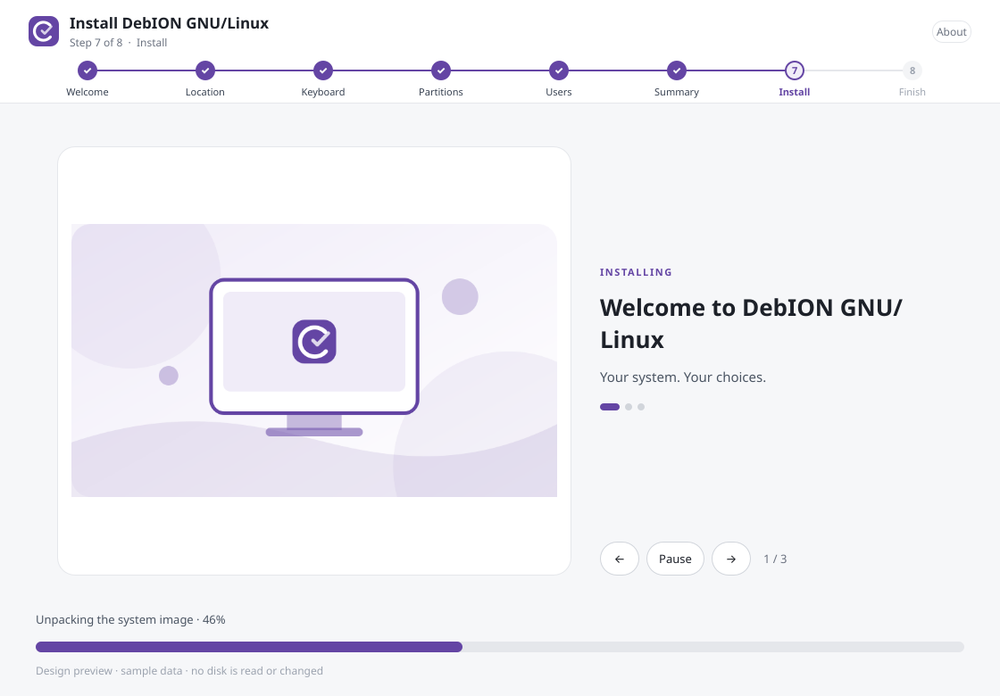
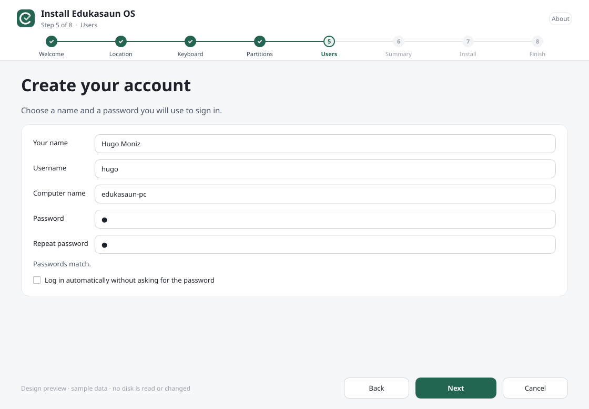
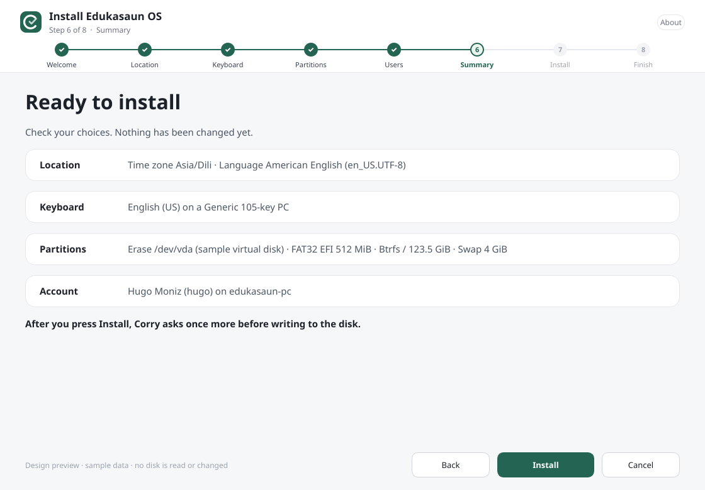

<!-- SPDX-License-Identifier: CC0-1.0 -->
# Corry Installer

> **Status: in development.** Corry has not yet been validated by full ISO
> installations on real hardware. Do not use it on a computer with data you
> cannot afford to lose.

Corry is the default system installer for **Edukasaun OS** and
**DebION GNU/Linux**. It is a fork of **Calamares 3.3.15** with one shared
installation engine and separate product assets for each distribution. Both
distributions are built on **Debian stable (13 "trixie")** and **Debian testing**;
Corry supports exactly those two bases.


| | |
| --- | --- |
|  |  |
|  |  |

The screenshots are **Qt design previews with sample data** made by
`tools/preview.py`. They use the production header and slideshow QML, stylesheet
and artwork, but the page bodies are a storyboard, not captures of a real
installation.

## What Corry does

- Welcome → Location → Keyboard → Partitions → Users → Summary → Install → Finish.
- A redesigned header with the product name and a step-by-step progress bar,
  a two-column welcome page with the system check, and a slideshow with
  pause, previous and next controls while installing.
- **Fully offline.** Everything is copied from the live image; there is no
  software selection page, no package download and no internet requirement.
- Btrfs by default (subvolumes `@`, `@home`, `@cache`, `@log`), with ext4 and XFS
  as alternatives, and Root/Home/EFI/Boot/Swap/Var/Tmp role shortcuts for
  manual partitioning.
- Passwords of one character or more; empty or mismatched passwords are rejected.
- Before anything starts, the launcher checks the host tools **and the contents of
  the live image** (kernel, initramfs-tools, GRUB files for this computer's
  firmware). A broken image is reported before any disk is touched.
- After unpacking, Corry removes the live-session packages and the installer's own
  launchers from the new system, installs `grub-pc` or `grub-efi-<arch>` from the
  boot medium's package pool (falling back to the GRUB files already in the image),
  enables os-prober for dual boot, then builds the initramfs and installs GRUB.
- US English (`en_US.UTF-8`) is the default language. Other languages can still be
  chosen on the welcome page.

## Build and integrate

Run inside a disposable Debian stable or testing machine, or in the ISO build chroot:

```bash
sudo bash tools/install-dependencies.sh build
bash tools/build-corry.sh
python3 tools/test-profile.py
QT_QPA_PLATFORM=offscreen ctest --test-dir build-corry \
  -R '^(userstest|partitionconfigtest|corrypartitiontest)$' --output-on-failure
sudo cmake --install build-corry
sudo bash tools/install-profile.sh --distro edukasaun
# Or, for the other distribution's ISO build root:
# sudo bash tools/install-profile.sh --distro debion
```

The scripts detect the Debian base from `/etc/debian_version` (`13.x` is stable,
`forky/sid` or `14.x` is testing). If a derivative changes that file, set
`CORRY_DEBIAN_BASE=stable` or `CORRY_DEBIAN_BASE=testing`. Both bases use Qt 6.
Set `CORRY_BUILD_JOBS` to tune parallelism.

### Corry as the default installer

`install-profile.sh` makes Corry the live session's installer:

| File | Purpose |
| --- | --- |
| `/usr/bin/corry-installer` | Launcher: preflight checks, then Calamares with the Corry profile |
| `/usr/share/applications/corry-installer.desktop` | "Install Edukasaun OS" / "Install DebION GNU/Linux" menu entry |
| `/etc/skel/Desktop/corry-installer.desktop` | Desktop icon for the live user |
| `/usr/local/share/applications/{calamares,install-debian}.desktop` | Hide Debian's generic installer entries |
| `/usr/local/bin/install-debian` | Redirect Debian's `install-debian` command to Corry |
| `/etc/xdg/autostart/corry-installer.desktop` | Only with `--autostart`: open Corry when the live session starts |

Nothing owned by a Debian package is overwritten. Do not add
`calamares-settings-debian` to the image; it ships a competing `/etc/calamares`.
All of these launchers are removed from the installed system by the
`corrycleanup` job.

The default image is `/run/live/medium/live/filesystem.squashfs`; override it with
`--image /absolute/path.squashfs`. The boot medium (two levels above the image)
is used for the GRUB package pool. `DESTDIR` stages a profile without changing
the host.

The live image must already contain everything the installed system needs:
a Debian kernel, firmware, desktop, login manager, initramfs-tools, `grub2-common`,
and `grub-pc-bin`/`grub-efi-amd64-bin` (or the full `grub-pc`/`grub-efi-amd64`
packages in the ISO's package pool). Include Corry's runtime dependencies
(`tools/install-dependencies.sh runtime`) **before packing** the squashfs.
Read the [integration and testing guide](docs/CORRY-DEVELOPMENT.md).

CI builds Corry on `debian:stable` and `debian:testing` and uploads development
archives for both distributions with SHA256 checksums. They are staged file trees
for ISO-build testing, not signed Debian packages or tested release ISOs.

## Edit a distribution without changing the engine

Edit only `config/distros/edukasaun/` or `config/distros/debion/`:

- `branding.desc`: product names and links.
- `profile.yaml`: product name, accent and tint colors.
- `slides/slides.json`: slideshow order, titles and descriptions (images can be SVG, PNG or JPEG).
- `slides/`: the slideshow images.

Re-run `install-profile.sh --distro …` after editing. It applies the colors to the
stylesheet, header, slideshow and logo, and generates the slideshow JavaScript.

## Safe preview and screenshots

```bash
pip install PySide6 PyYAML
python3 tools/preview.py --distro edukasaun
QT_QPA_PLATFORM=offscreen python3 tools/preview.py --distro debion --screenshots docs/screenshots
```

The preview cannot install anything or access disks. A full ISO installation and
reboot in BIOS and UEFI virtual machines is still required before a release.

## Licensing

Upstream per-file licenses and notices are retained; see `LICENSES/`. New Corry code
uses GPL-3.0-or-later unless marked otherwise; original artwork is CC0-1.0. The
configuration is derived from
[CatalystDevOrg/calamares-settings-debian](https://github.com/CatalystDevOrg/calamares-settings-debian),
kept in `config/upstream/catalyst` with its ISC notice
([source provenance](config/upstream/catalyst/UPSTREAM.md)). No Microsoft, Mint or
Catalyst artwork is shipped. Calamares upstream: https://codeberg.org/Calamares/calamares
