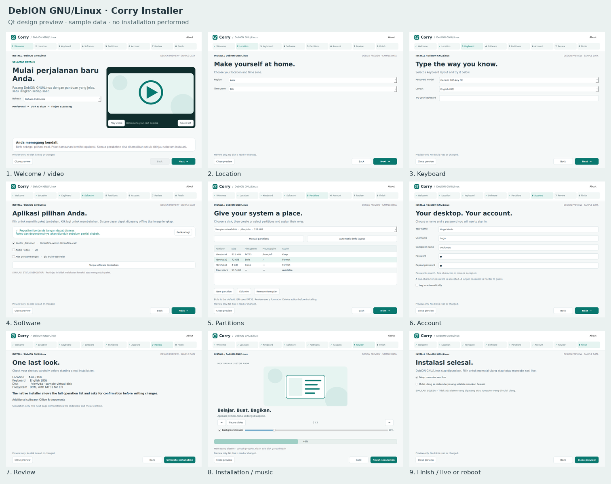
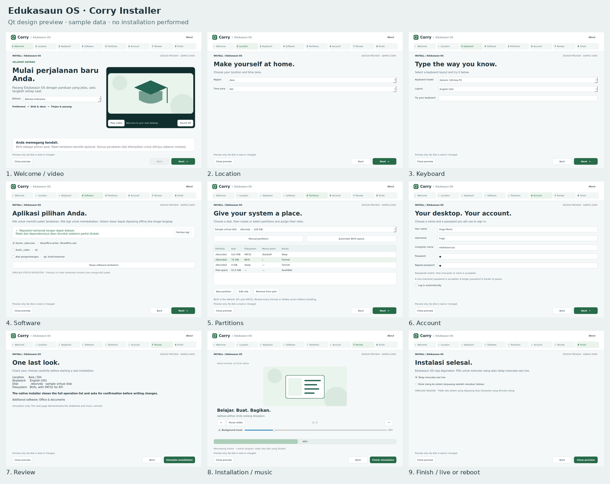

<!-- SPDX-License-Identifier: CC0-1.0 -->
# Corry — welcome sampai finish

Screenshot Qt dengan data contoh, menggunakan QML header/video/slideshow dan stylesheet produksi. Isi halaman lain adalah storyboard. Status repo, disk, progres dan hasil selesai merupakan simulasi; screenshot bukan bukti pemasangan atau reboot ISO.

[Buka galeri lengkap](gallery.html). Klik gambar tahap untuk resolusi penuh.

## DebION GNU/Linux

| Tahap | Screenshot |
| --- | --- |
| Welcome / video | [01-welcome.png](debion/01-welcome.png) |
| Location | [02-location.png](debion/02-location.png) |
| Keyboard | [03-keyboard.png](debion/03-keyboard.png) |
| Software | [04-software.png](debion/04-software.png) |
| Partitions | [05-partitions.png](debion/05-partitions.png) |
| Account | [06-account.png](debion/06-account.png) |
| Review | [07-review.png](debion/07-review.png) |
| Installation / music | [08-installation.png](debion/08-installation.png) |
| Finish / live or reboot | [09-finish.png](debion/09-finish.png) |

## Edukasaun OS

| Tahap | Screenshot |
| --- | --- |
| Welcome / video | [01-welcome.png](edukasaun/01-welcome.png) |
| Location | [02-location.png](edukasaun/02-location.png) |
| Keyboard | [03-keyboard.png](edukasaun/03-keyboard.png) |
| Software | [04-software.png](edukasaun/04-software.png) |
| Partitions | [05-partitions.png](edukasaun/05-partitions.png) |
| Account | [06-account.png](edukasaun/06-account.png) |
| Review | [07-review.png](edukasaun/07-review.png) |
| Installation / music | [08-installation.png](edukasaun/08-installation.png) |
| Finish / live or reboot | [09-finish.png](edukasaun/09-finish.png) |

